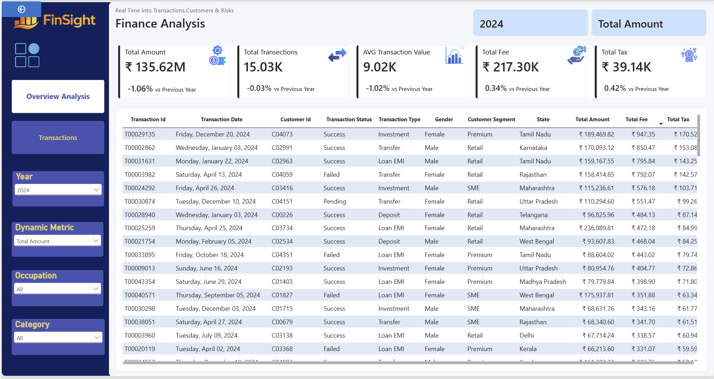
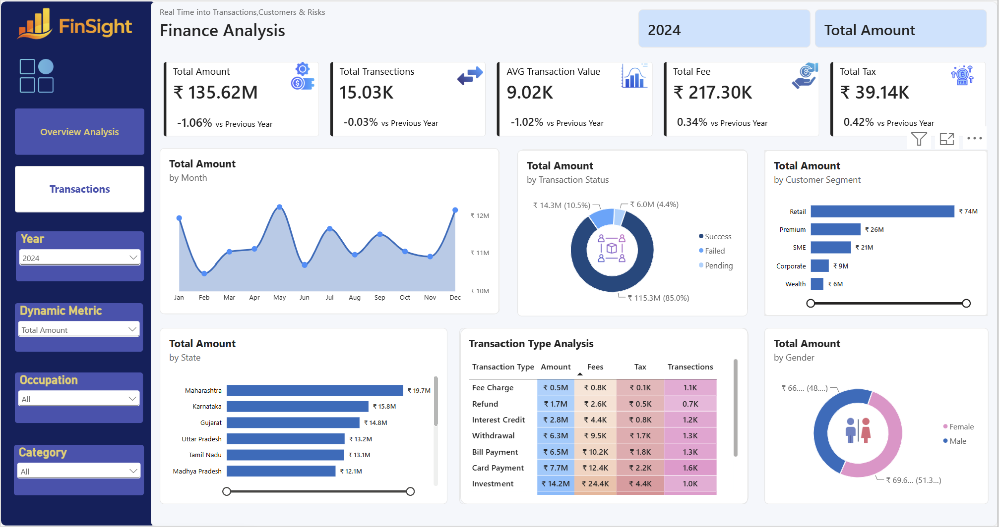

# FinSight Finance Dashboard

FinSight is a Power BI report for exploring financial transactions and customer attributes. The report has two pages: **Overview Analysis** for aggregated views and **Transactions** for row-level detail.

## Dashboard preview

### Overview Analysis



### Transactions



## What the report shows

The overview page includes KPI cards for total amount, transaction count, average transaction value, fees, and tax. It also presents:

- Monthly total amount
- Total amount by transaction status and customer segment
- Total amount by state and gender
- A transaction type table with amount, fees, tax, and transaction count

The transactions page provides a detailed table with transaction ID and date, customer ID, status, transaction type, gender, customer segment, state, amount, fee, and tax.

Both pages show a year selector and a dynamic metric selector. The report also includes occupation and category filters. The visible currency formatting is Indian rupees (₹); the screenshots show the year 2024 selected.

## Tools

- Microsoft Power BI Desktop
- DAX measures are visible in the report model and visuals

The model pane shows tables named `Calender Table`, `customers`, `Dynamic Metric`, and `finance_transactions`. The upstream source system and data preparation process are not documented in the supplied project files.

## Repository contents

```text
.
├── README.md
├── overview-analysis.png
└── transactions.png
```

The Power BI report file can be added to this repository when ready for sharing. No raw source data is included here.

## Notes

Dashboard values and comparisons shown in the screenshots describe the report's current 2024 selection. They are included as examples of what is displayed, not as independently validated business results. Confirm that the underlying data is safe and permitted to share before publishing the `.pbix` file or any data extracts.
